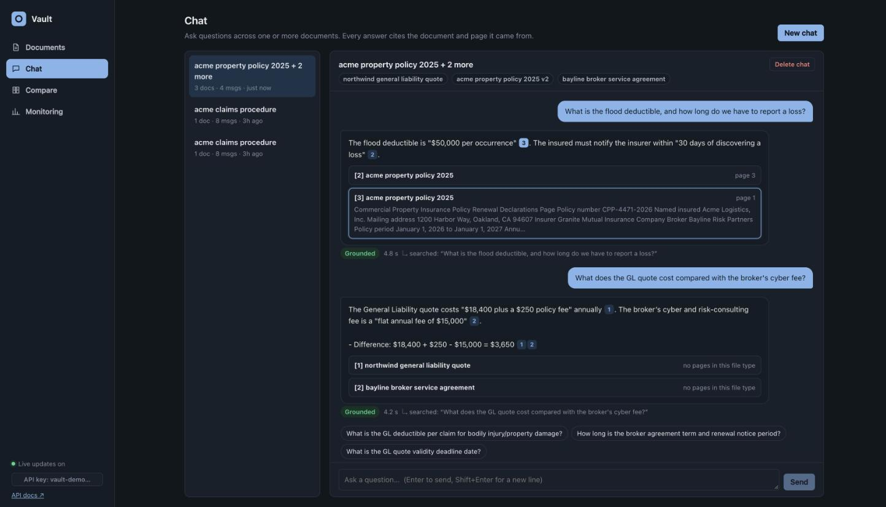
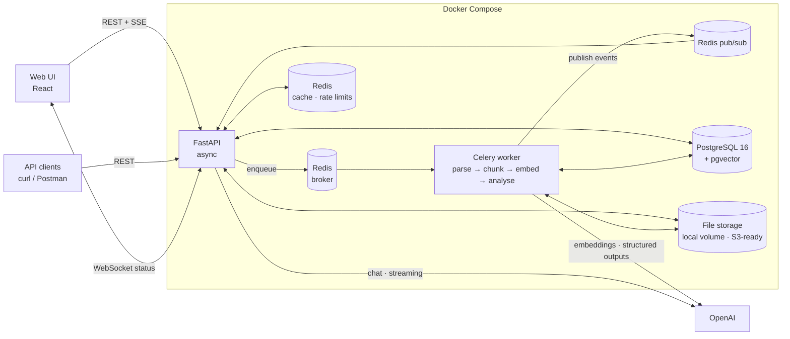
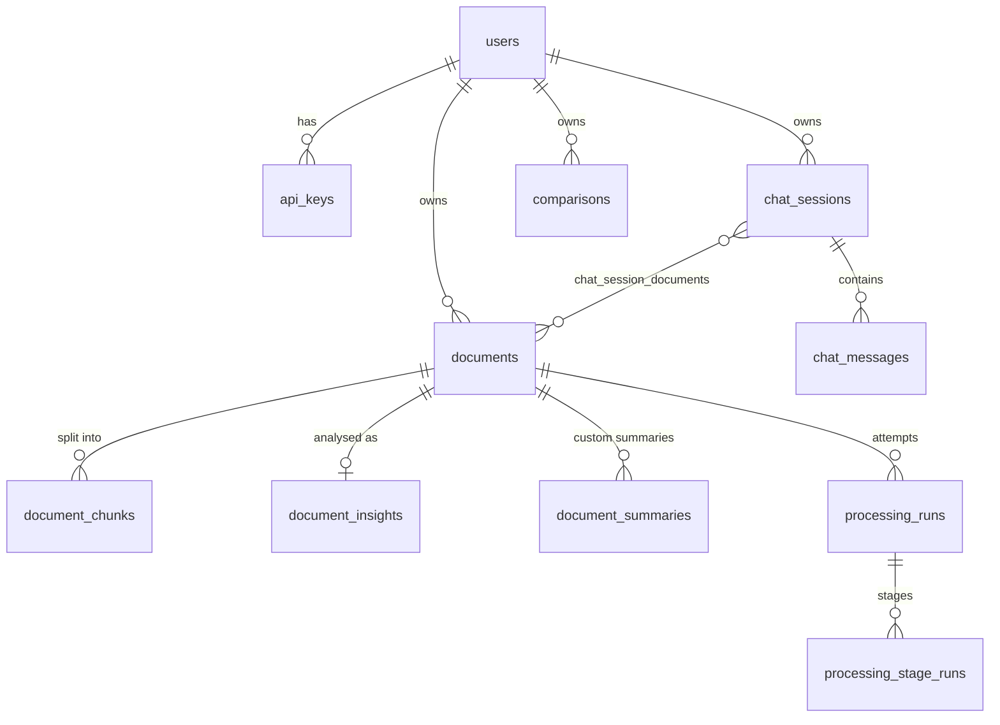

# AI Vault Document System

Upload documents, get AI insights, and **chat with them in natural language, with every answer cited down to the document and page**. Think "ChatGPT for your documents", built as a production-style backend with a simple web UI. It runs as one command on a laptop and is designed for thousands of documents.

**At a glance:** every required component and every bonus point in the brief is built and working · 153 automated tests · a 25-question RAG eval with real models scoring 100% on answers, citations (document and page) and abstention · uploads answer in 17 ms and documents are ready in about 4 s · about $0.004 to process a document and about $0.002 per answered question.

**How I approached it:**

- **Built for a real user.** The samples are an insurance broker's vault: a property policy and its renewal, a liability quote, a broker agreement, a claims procedure. Every feature answers a question that user has: *what does it say, where exactly, what changed at renewal, how does this quote compare?*
- **Answers you can trust over answers that sound good.** Every claim is cited to a document and page; when the documents don't say, the system says so instead of guessing; numbers are quoted exactly and calculations show their working.
- **The API never waits on AI.** Uploads return `202` at once; parsing, embedding, analysis and comparisons run in background workers, with live status over WebSocket.
- **Failure paths are designed, not discovered.** Bad files, lost jobs, killed workers, provider outages, oversized uploads and Redis being down each have a defined, tested behaviour.
- **Measured, not assumed.** A labelled eval scores every prompt or model change; every AI call is metered by operation, model and prompt version; cache savings are counted.
- **Simple to run, simple to change.** One command to start; strict layering; one file per prompt; a provider interface; [AGENTS.md](AGENTS.md) for the next engineer or AI agent.

```
make up            # → UI on http://localhost:9700 · API docs on http://localhost:9700/docs · API key: vault-demo-key
```

**Demo video (3 min):** [docs/demo.mp4](docs/demo.mp4): uploads and failures, insights, a new version, multi-turn chat with citations, comparison and monitoring, on the live app with real AI calls.



More screenshots: [documents and insights](docs/screenshots/documents.png) · [comparison](docs/screenshots/compare.png) · [monitoring](docs/screenshots/monitoring.png)

---

## Contents

1. [Quick start](#1-quick-start)
2. [What's included (mapped to the brief)](#2-whats-included)
3. [Architecture and flow](#3-architecture-and-flow)
4. [API overview (with curl)](#4-api-overview)
5. [Data model](#5-data-model)
6. [How chat (RAG) works](#6-how-chat-rag-works)
7. [Design decisions, trade-offs and assumptions](#7-design-decisions-trade-offs-and-assumptions)
8. [Scaling to thousands of documents](#8-scaling-to-thousands-of-documents)
9. [Reliability, errors and observability](#9-reliability-errors-and-observability)
10. [Testing and evaluation](#10-testing-and-evaluation)
11. [Project structure](#11-project-structure)
12. [Documentation map](#12-documentation-map)

---

## 1. Quick start

**Prerequisites:** Docker Desktop (or Docker Engine with Compose v2) and an OpenAI API key.

```bash
git clone <this repo> && cd ai-vault-document-system
make setup                 # creates .env from .env.example
# edit .env and set OPENAI_API_KEY=sk-...
make up                    # builds and starts db, redis, api (+UI) and worker; waits until healthy
```

| What | Where |
|---|---|
| Web UI | http://localhost:9700 |
| Interactive API docs (Swagger) | http://localhost:9700/docs |
| Health / readiness | http://localhost:9700/health · http://localhost:9700/health/ready |
| API key (pre-seeded demo user) | `vault-demo-key` (header `X-API-Key`) |

There's no `make`? Use `cp .env.example .env` then `docker compose up --build -d`.

**Try it:** open the UI, drop in the files from [`samples/`](samples/), wait a few seconds for "Ready", then chat. A good five-minute tour:

1. Upload the 2025 policy, the quote, the broker agreement and the claims procedure, plus `edge-cases/corrupt.pdf` and `edge-cases/scanned_no_text.pdf`: the good ones turn **Ready**, then **Insights**; the bad ones fail with a clear reason.
2. Open the property policy: summary, key facts with pages, tags, a custom summary (try *executive*, focus *flood*).
3. Upload `acme_property_policy_2026_renewal.pdf` with **Upload new version** on the 2025 policy.
4. Chat with the policy, the quote and the agreement: *"What is the flood deductible, and how long do we have to report a loss?"*, then *"And for earthquake?"*, then *"Who is the CEO?"* (it says it can't find it).
5. Compare v2 with v1, focus *what changed at renewal*.
6. Open Monitoring: processing times, AI cost by operation, cache savings, API latency.

Or run the whole scenario automatically:

```bash
make smoke   # end-to-end: upload → process → insights → versioning → chat → streaming → summary → compare → metrics
make test    # 153 tests in Docker with a fake AI provider (no API key or cost)
make eval    # RAG quality evaluation (25 questions) against the running stack
make help    # all commands
```

**Ports** (all configurable in `.env`): API/UI `9700`, Postgres `9701`, Redis `9702`.
**Stop:** `make down` (keeps data) · `make reset` (deletes data).

<details>
<summary><b>Running without Docker for the app (local development)</b></summary>

Postgres and Redis still run in Docker; the API, worker and UI run on your machine with hot reload.

```bash
cd backend && python3.12 -m venv .venv && source .venv/bin/activate && pip install -r requirements-dev.txt && cd ..
make dev-api      # terminal 1: migrations + API with --reload on :9700
make dev-worker   # terminal 2: Celery worker
make dev-ui       # terminal 3 (optional): UI dev server on :5173 with hot reload
```
</details>

---

## 2. What's included

**Every requirement in the brief:**

| Brief | How it is built |
|---|---|
| Intelligent upload handler | Type, size and empty checks, content sniffing (a renamed `.exe` is rejected), duplicate detection by SHA-256, versions, batch upload with per-file errors, a size limit enforced before the body is read |
| Smart document analysis | One structured AI call per document: summary, type, category, tags, key points, key facts with pages, entities, sentiment, suggested questions; map-reduce for long documents |
| Asynchronous processing pipeline | Celery + Redis: parse → chunk → embed → analyse, with retries, time limits, per-document locks, live status and a sweep that recovers lost or stuck jobs |
| Upload & ingestion · Document retrieval · AI insights | `POST /documents` (+ `/batch`) · `GET /documents`, `/{id}`, `/status`, `/file`, `/versions` · `GET /{id}/insights`, `POST /{id}/summaries` |
| Start chat session · Ask question · Chat history · Multi-turn context | `POST /chat/sessions` (one or many documents) · `POST /messages` and `/messages/stream` · `GET /chat/sessions/{id}` · follow-ups rewritten into standalone questions using the last 6 turns |
| Document statistics API · Processing metrics API | `GET /metrics/documents` (counts, success rate, p50/p95, per-stage timings, errors, queue wait), plus `/metrics/ai-usage`, `/metrics/api`, `/metrics/system` |
| Data storage (metadata and status, insights, conversations, messages with citations, processing metrics, performance data) | `documents`, `document_insights` + `document_summaries`, `chat_sessions`, `chat_messages` (citations + retrieval trace), `processing_runs` + `processing_stage_runs`, `request_metrics` + `ai_usage` (§5) |
| Demo | [The demo video](docs/demo.mp4) and the five-minute tour above |

**Every bonus point:** multi-document chat · intelligent follow-up suggestions · summary customisation (length, focus, tone) · automated categorisation and tagging · sentiment and key-insight extraction · comparative analysis · a simple web UI · real-time updates over WebSocket · smart caching (embeddings and answers in Redis) · pgvector · streaming chat over SSE · 153 tests · cost tracking and optimisation · rate limiting and quotas · document version tracking · batch processing optimisations · structured logging and observability · health checks and monitoring endpoints. Where each lives:

| Area | Feature | Where |
|---|---|---|
| **Document processing** | Upload validation (type, size, empty, *content sniffing*, so a renamed `.exe` is rejected) | `services/documents.py` |
| | Async pipeline: parse → chunk → embed → analyse (Celery), returns `202` immediately | `services/processing.py` |
| | PDF (with tables and page numbers), DOCX (with tables), TXT, Markdown | `services/parsing.py` |
| | Clear failures: scanned/image-only PDF, corrupt, password-protected, empty, bad encoding | `services/parsing.py` |
| | Retries with backoff for transient AI errors; idempotent (per-document lock); time limits; a sweep that recovers lost or stuck jobs | `workers/tasks.py` |
| **AI insights** | Summary, document type, category, tags, key points, **key facts with page numbers**, entities, sentiment, suggested questions | `services/insights.py` |
| | Long documents: map-reduce (section notes, 8 in parallel → final analysis); notes saved for later summaries | `services/insights.py` |
| | **Customisable summaries** (length × tone × focus), stored and reused | `POST /documents/{id}/summaries` |
| **Chat** | Sessions over **one or many documents**; history; **multi-turn** (follow-ups rewritten into standalone questions) | `services/chat.py` |
| | **Hybrid retrieval** (pgvector + Postgres full-text, RRF fusion) | `services/retrieval.py` |
| | **Citations** `[n]` mapped to document, page and snippet; **abstains** when the answer isn't in the documents | `llm/prompts/chat.py` |
| | **Streaming** answers (SSE) and **follow-up suggestions**, generated in parallel with the answer and checked so they don't repeat it or the chat | `/messages/stream` |
| | Delete a conversation; a chat whose documents were all deleted says so | `DELETE /chat/sessions/{id}` |
| **Advanced AI** | **Document comparison** (2–5 docs, e.g. policy v1 vs v2): structured differences with values, pages and impact. For versions of one document, the code computes the word-level changes and gives them to the model, so nothing changed is missed | `services/comparison.py` |
| **Product** | **Versioning** (upload a new version; history; open any older version; delete promotes the previous one) | `POST /documents` + `replaces_document_id` |
| | **Download the original file** | `GET /documents/{id}/file` |
| | **Duplicate detection** (same content returns the existing document, so nobody pays twice) | `services/documents.py` |
| | **Batch upload** with per-file errors | `POST /documents/batch` |
| | **Real-time status** over WebSocket (Redis pub/sub) | `/api/v1/events` |
| | Simple **web UI** (React + TypeScript): documents (drag-and-drop or file picker), insights, chat with clickable citations, compare, monitoring | `frontend/` |
| **Production** | **Cost tracking**: every model call stored with tokens, latency, USD | `services/usage.py` |
| | **Rate limiting** and a **daily token quota** per user, across all of that user's API keys | `core/rate_limit.py` |
| | **Body-size limits** checked before authentication or parsing (`413` before an oversized upload is read) | `core/body_limit.py` |
| | **Caching**: embeddings (Redis); answers (Redis, keyed by document and prompt versions), also matched **by meaning** so paraphrases reuse an answer, but only when numbers and names match; insights and summaries (DB) | `services/cache.py` |
| | **Metrics APIs**: documents, processing (p50/p95, per stage, errors), AI usage and cost, chat quality, API latency per route, system health and queue depth | `services/metrics.py` |
| | Health and readiness probes; structured JSON logs with request IDs | `api/health.py`, `main.py` |
| | API-key auth (hashed keys, create / list / revoke) with per-owner data isolation | `core/security.py`, `/api-keys` |

---

## 3. Architecture and flow



**Upload → ready**

1. `POST /documents`: validate (extension, size, magic bytes), SHA-256 for duplicates, store the file, create the row (`queued`), enqueue, return **202**.
2. The worker takes a per-document lock and records a `ProcessingRun`:
   - **parse**: text per page (tables included).
   - **chunk**: ~700 tokens, 100 overlap, never across pages, so every chunk has one page number.
   - **embed**: batched, with a Redis embedding cache. It stores the vectors; the full-text vector is generated by Postgres.
3. The document becomes **`ready`** (chat works now). Then **analyse** generates insights. If that step fails, the document stays chat-ready and insights can be retried.
4. Every stage writes timings, and every status change is pushed to the browser over WebSocket.

**Ask → answer:** see [§6](#6-how-chat-rag-works).

---

## 4. API overview

Full interactive docs: **http://localhost:9700/docs**. All endpoints are under `/api/v1` and need `X-API-Key`.
Errors always look like `{"error": {"code", "message", "details", "request_id"}}`, including framework errors (unknown route, wrong method, unreadable body). Every endpoint lists its error responses in `/docs`.

| Method | Path | Purpose |
|---|---|---|
| POST | `/documents` | Upload (multipart `file`, optional `title`, `replaces_document_id`) → 202 |
| POST | `/documents/batch` | Upload many (`files`), per-file results and errors |
| GET | `/documents` | List; filters `status`, `category`, `tag`, `q`, `include_old_versions`; paging |
| GET | `/documents/{id}` · `/status` · `/file` | Details · lightweight status for polling · the original file |
| GET | `/documents/{id}/insights` | AI summary, category, tags, key facts (with pages), entities, sentiment |
| POST | `/documents/{id}/summaries` | Custom summary `{length, tone, focus}` |
| GET | `/documents/{id}/versions` · `/processing-runs` | Version history · per-attempt stage timings |
| POST | `/documents/{id}/reprocess` · `/insights/regenerate` | Retry processing · retry analysis only |
| DELETE | `/documents/{id}` | Delete a version |
| POST | `/chat/sessions` | Start a chat over `document_ids` (1–20) |
| GET | `/chat/sessions` · `/chat/sessions/{id}` | List · full history with citations |
| DELETE | `/chat/sessions/{id}` | Delete a conversation |
| POST | `/chat/sessions/{id}/messages` | Ask; returns answer, citations, follow-ups, grounded/abstained flags |
| POST | `/chat/sessions/{id}/messages/stream` | Same, streamed as SSE: `status` → `token`… → `done` |
| POST / GET | `/comparisons` · `/comparisons/{id}` | Compare 2–5 documents (background job) · list · result |
| DELETE | `/comparisons/{id}` | Delete a comparison (`409` while it is running) |
| GET | `/metrics/documents` · `/ai-usage` · `/api` · `/system` | Monitoring |
| WS | `/events` | Live document, comparison and chat events. Header `X-API-Key`, or for browsers a single-use `?ticket=` from `POST /events/ticket`, so the key never appears in a URL |
| POST / GET / DELETE | `/api-keys` | Create (shown once) · list · revoke API keys |
| GET | `/config` | Upload rules (allowed types, size and batch limits), so clients never hard-code them |
| GET | `/health` · `/health/ready` | Liveness · readiness (DB, Redis, worker heartbeat, AI key) |

**Copy-paste walkthrough**

```bash
K="X-API-Key: vault-demo-key"; B=http://localhost:9700/api/v1

# Upload (returns 202 and the document id)
DOC=$(curl -s -H "$K" -F file=@samples/acme_property_policy_2025.pdf $B/documents | python3 -c "import sys,json;print(json.load(sys.stdin)['document']['id'])")

# Watch status (or subscribe to the WebSocket)
curl -s -H "$K" $B/documents/$DOC/status

# Insights
curl -s -H "$K" $B/documents/$DOC/insights

# Upload the renewal as version 2
V2=$(curl -s -H "$K" -F file=@samples/acme_property_policy_2026_renewal.pdf -F replaces_document_id=$DOC $B/documents | python3 -c "import sys,json;print(json.load(sys.stdin)['document']['id'])")

# Chat across documents
S=$(curl -s -H "$K" -H "Content-Type: application/json" -d "{\"document_ids\":[\"$V2\"]}" $B/chat/sessions | python3 -c "import sys,json;print(json.load(sys.stdin)['id'])")
curl -s -H "$K" -H "Content-Type: application/json" -d '{"question":"What is the flood deductible?"}' $B/chat/sessions/$S/messages
curl -s -H "$K" -H "Content-Type: application/json" -d '{"question":"And for earthquake?"}' $B/chat/sessions/$S/messages

# Stream an answer
curl -N -H "$K" -H "Content-Type: application/json" -d '{"question":"What is excluded?"}' $B/chat/sessions/$S/messages/stream

# Compare v1 and v2
curl -s -H "$K" -H "Content-Type: application/json" -d "{\"document_ids\":[\"$DOC\",\"$V2\"],\"focus\":\"what changed at renewal\"}" $B/comparisons

# Metrics
curl -s -H "$K" $B/metrics/ai-usage
```

Example answer (trimmed):

```json
{
  "content": "The flood deductible is \"$50,000 per occurrence\" [1].",
  "citations": [{"number": 1, "document_title": "acme property policy 2025", "page_number": 1,
                 "snippet": "… Flood deductible: $50,000 per occurrence …", "similarity": 0.45}],
  "follow_up_questions": ["What is the earthquake deductible?", "…"],
  "grounded": true, "abstained": false, "standalone_question": "What is the flood deductible?",
  "from_cache": false, "latency_ms": 2350
}
```

---

## 5. Data model



| Table | Holds | Notes |
|---|---|---|
| `documents` | Metadata, status/stage, error code and message, counts, timings, `content_hash`, `version_group_id` / `version` / `is_latest` | Each version is its own row: simple queries, old versions stay chat-able |
| `document_chunks` | Text, page, token count, `embedding vector(1536)`, `tsv tsvector` (generated) | HNSW index (cosine) + GIN index; `owner_id` denormalised for safe, fast filtering |
| `document_insights` | Summary, type, category, tags, key points, key facts (with page), entities, sentiment, suggested questions, model, prompt version | JSONB for flexible structured output |
| `document_summaries` | Custom summaries per (length, tone, focus) | Unique per variant = cache |
| `chat_sessions`, `chat_messages` | Conversations; each answer stores the **standalone question, citations, retrieval trace** (chunks, scores), grounded/abstained, tokens, latency | Fully auditable answers |
| `processing_runs`, `processing_stage_runs` | Every attempt and stage with duration, status, details, error | Feeds processing metrics |
| `ai_usage` | Every model call: operation, model, prompt version, tokens, cost, latency, success, cached | Feeds cost metrics and quotas |
| `request_metrics` | Method, route template, status, latency | Feeds API performance metrics |
| `comparisons` | Document ids, focus, status, structured result | Background job state |

Schema is managed by **Alembic** (`backend/alembic/versions/`), applied automatically on API start.

---

## 6. How chat (RAG) works

```
question ──► (follow-up?) rewrite to standalone question   [fast model, uses last 6 turns]
         ──► answer cache, exact?  (owner + document versions + question + prompt version)
         ──► embed question (Redis-cached)
         ──► answer cache, by meaning?  (cosine ≥ 0.88 with an answered question on the same documents,
                                         and the same numbers and names)
         ──► hybrid search over the session's ready documents only
               • vector: pgvector cosine (HNSW), top 24
               • keyword: Postgres websearch_to_tsquery + ts_rank_cd, top 24
               • Reciprocal Rank Fusion → top 6
         ──► drop weak evidence (cosine < 0.2 unless it matched keywords)
               └─ nothing left → abstain without calling the model (no hallucination, no cost)
         ──► answer with numbered sources [1]..[n] (title + page), history for tone
               (gpt-5.4-mini with low reasoning, so multi-step arithmetic stays right)
         ──► map [n] → chunk → {document, page, snippet}; ignore invented numbers
         ──► quoted figures not found in the sources lose their quotation marks (a computed total is not a quote)
         ──► grounded = has valid citations; abstained = starts with the fixed "not found" sentence
         ∥   follow-up candidates, generated in parallel with the answer (fast model; answerable from the same sources)
         ──► check candidates against this answer and the chat's earlier answers (fast model + embeddings, in parallel)
         ──► store message + retrieval trace + usage; cache the answer (never a "not found")
```

Why each step exists:

- **Hybrid search**: embeddings catch paraphrases ("pipe bursts" ≈ "discharge of plumbing systems"), while keywords catch exact identifiers that embeddings blur ("CPP-4471-2026", "Section 4.2", names). RRF needs no score calibration between the two.
- **Query rewriting**: "And for earthquake?" retrieves nothing useful on its own. It's rewritten to "What is the earthquake deductible on the property policy?" (visible in the UI and API as `standalone_question`).
- **Fixed abstention sentence**: makes "not in the documents" machine-detectable, so it's measurable (`abstention_rate`) and never cached.
- **Numbered sources with page labels**: citations are deterministic. The model cites `[2]` and the code knows exactly which chunk and page that is.
- **Prompt-injection defence**: document text is wrapped and declared as untrusted data. The eval includes an injection case.
- **Checked follow-ups**: generating them from the sources (not the answer) lets them run in parallel with the answer; a second check then drops any the answer or the chat already covered. The design was chosen by measuring three options (see AI_USAGE.md §3).

The full prompt and its reasoning are in [AI_USAGE.md](AI_USAGE.md#11-the-chat-prompt).

---

## 7. Design decisions, trade-offs and assumptions

Where the brief offered a choice ("X or Y"), one option was chosen deliberately:

| Choice | Picked | Why (and the trade-off) |
|---|---|---|
| Framework | **FastAPI** | Async I/O for many concurrent LLM calls, typed request/response models, automatic OpenAPI docs |
| Database | **Local PostgreSQL 16 + pgvector** (not Supabase) | Reviewers run it offline with one command; vectors live next to the data (one transaction, joins, per-owner filters). Trade-off: a dedicated vector DB scales further; see §8 |
| Task queue | **Celery + Redis** (not RQ) | Retries with backoff, acks-late (no lost jobs if a worker dies), routing to separate queues, beat scheduler. Heavier than RQ, but production-proven |
| File parsing | **pdfplumber** (not PyPDF2) + python-docx | Better text layout and **table extraction**, which matters for insurance declarations pages |
| LLM | **OpenAI** behind a provider interface | `gpt-5.4-mini` (answers, insights, comparison, summaries; chat answers with low reasoning, measured to keep arithmetic right a few turns into a chat), `gpt-5.4-nano` (rewrite, follow-ups, the follow-up check, long-document notes), `text-embedding-3-small`. Swapping to Claude is one new class (`llm/base.py`). See AI_USAGE.md for model choice and cost |
| Framework for RAG | **LangChain text splitter only**; retrieval and prompts in plain code | The splitter is solid and saves time; the retrieval logic and prompts are the product, so they stay explicit, testable and easy to change in an interview |
| Embeddings | **OpenAI text-embedding-3-small** (not sentence-transformers) | Strong quality at $0.02/1M tokens; no 1–2 GB model in the image, and fast cold starts. Trade-off: network dependency (mitigated by caching) |
| Storage | **Local volume behind a `Storage` interface** | Zero setup; S3 is a drop-in class with the same three methods |
| Streaming | **SSE for chat, WebSocket for status** | SSE fits one-way token streams over plain HTTP (works with POST, proxies, curl). WebSocket fits long-lived, multi-event status updates |

**How scope was prioritised**

The brief says document chat is the key feature and prefers a fully working subset to partial features. Effort was weighted accordingly:

1. **Document chat done properly:** hybrid retrieval, page-level citations, honest "not found", multi-turn, streaming, then an eval to prove it.
2. **A pipeline that never loses or corrupts work:** clear failure codes, retries, locks, recovery of lost jobs.
3. **Bonus features chosen for the user's real workflow:** versions and comparison (renewals are a broker's daily work), multi-document chat (policy vs quote vs agreement), summaries for different readers.
4. **Production concerns that change behaviour, not just dashboards:** quotas and rate limits, cost per operation, caches that are safe to reuse.
5. **A thin UI** over the same public APIs, so everything shown is also available to any API client.

Each feature was built as a vertical slice, end to end with tests, against the real stack.

**Other decisions**

- **"Ready" before insights.** Chat is available as soon as embeddings are stored (seconds). Insights (the slowest step) run after and fail independently.
- **Version = new row.** Old versions stay queryable and comparable; `is_latest` keeps lists clean. The answer cache keys on document versions, so a new version never serves stale answers.
- **Duplicates return the existing document** (200 instead of 202) rather than an error: the user's intent is satisfied, and nobody pays to process the same bytes twice.
- **Deterministic fake provider for tests**, using feature-hashed embeddings, so retrieval behaves meaningfully. Tests are free, offline and stable.
- **Code computes, the model explains.** Citations, "not found", which quotes are real and the changes between versions are computed by code; the model is used where language understanding is needed.
- **Limits are per user, not per key**, so creating more keys never means more quota.
- **API keys hashed (SHA-256)**; a demo key is seeded on startup so reviewers can start immediately.

**Assumptions**

- Documents are text-based. Scanned (image-only) PDFs are detected and fail with a clear message (`no_extractable_text`), so nobody is left with a document that silently answers nothing.
- English full-text configuration (the embeddings themselves are multilingual).
- Each user's data is private to that user (across all of their API keys); sharing documents between users is out of scope.
- Max 25 MB per file (configurable).

---

## 8. Scaling to thousands of documents

What's already in place:

- **The API never blocks on AI work.** Uploads return 202, and the queue absorbs bursts. Workers scale horizontally (`docker compose up --scale worker=4`), with separate queues for document processing and analysis so long comparisons never delay uploads.
- **Indexes for the hot paths:**
  - HNSW for vectors, GIN for full-text.
  - `(owner_id, created_at)`, `(owner_id, status)` and `(owner_id, content_hash)` on documents.
  - Retrieval is filtered by owner and document ids, and `hnsw.iterative_scan` keeps recall high under filters.
- **Cost control:**
  - Embedding cache (re-uploads and re-processing are free).
  - Answer cache.
  - Duplicate detection.
  - Cheaper "nano" model for auxiliary calls.
  - Map-reduce for long documents, 8 sections in parallel, with the notes saved so later summaries cost one call.
  - Daily token quota per user.
- **Batched embeddings** (96 chunks per request) and bulk inserts.
- **Safety nets:** a periodic task re-queues documents stuck in `queued`, and a per-document lock prevents double processing.

The growth path beyond that (roughly 100k+ documents or many concurrent users), with each change behind an existing interface:

| Pressure | Change |
|---|---|
| Storage | S3 + presigned uploads (the client uploads directly; the API only registers) |
| Vector search | Partition `document_chunks` by owner; or move vectors to a dedicated store (pgvector → Qdrant/pgvecto.rs) behind the existing retrieval function |
| Worker throughput | Autoscale workers on queue depth (already exposed in `/metrics/system`); OpenAI Batch API for bulk insights at half price |
| Metrics tables | Time-partitioning / retention for `request_metrics` and `ai_usage`, or ship them to Prometheus/OTel |
| Beat | Run Celery beat as its own single service when there are several worker replicas |

---

## 9. Reliability, errors and observability

**Failure handling**

- Invalid input is rejected at upload with a specific code: `unsupported_file_type`, `invalid_file_content`, `file_too_large`, `empty_file`.
- Unreadable documents become `failed` with a user-facing message: `no_extractable_text`, `corrupt_file`, `password_protected`, `encoding_error`, `empty_document`.
- Transient AI errors (timeouts, rate limits, 5xx) are retried (SDK retries, then job retries at 10s/30s/90s). Only the final failure marks the document `failed`, and `POST /reprocess` retries it.
- Provider errors are never leaked: chat returns `503 ai_service_unavailable` / `ai_request_failed` in the standard error envelope.
- Workers ack late, so a crashed worker's job is redelivered rather than lost.
- A periodic sweep re-sends lost jobs (without duplicating ones still waiting in a long queue), fails insights left pending by a killed worker so "Retry insights" appears, and closes runs left open.
- Reprocessing is refused (`409 already_processing`) while a job holds the document, and a manual reprocess resets the attempt count.
- Oversized requests are refused with `413` before authentication or parsing, so a huge upload is never written to disk.

**Performance** (measured on a laptop through `/metrics`, real models)

| What | p50 | p95 |
|---|---|---|
| Upload accepted (`POST /documents`, returns 202) | 17 ms | 98 ms |
| Document ready (parse, chunk, embed, analyse) | 4.1 s | 6.3 s |
| Chat answer, full (non-streaming; 25-question eval) | 2.4 s | 3.1 s |
| Chat answer, streaming: response starts | 15 ms | 31 ms |
| Comparison accepted (`POST /comparisons`, runs in the background) | 21 ms | 42 ms |
| Document list | 8 ms | 26 ms |

**Security**

- API keys are stored hashed (SHA-256), created and revoked through `/api-keys`; the full key is shown only once.
- Every query is filtered by owner, so one user can never read another's documents, chats or metrics.
- The WebSocket uses a single-use, 60-second ticket, so the API key never appears in a URL or a log.
- Uploads are checked by content, not just extension, and oversized bodies are refused before they are read.
- Document text is treated as untrusted data in every prompt (prompt-injection defence, tested in the eval).
- Logs carry request ids and metadata, not API keys or document contents; provider errors are never passed through to clients.

**Observability**

- JSON logs (structlog) with a `request_id` on every line; it's also returned as the `X-Request-ID` header and inside every error body.
- Metrics APIs and the Monitoring page:
  - processing success rate and p50/p95
  - per-stage timings and error codes
  - queue wait
  - AI tokens and cost by operation and model, and the cost saved by caches
  - chat latency, grounded / abstention / cache-hit rates
  - API p50/p95 and error rates per route
  - DB, Redis, worker heartbeat and queue depth
- `/health` (liveness) and `/health/ready` (DB, Redis, worker heartbeat, AI key configured): ready for container orchestrators.

---

## 10. Testing and evaluation

| Command | What | Cost |
|---|---|---|
| `make test` | 153 tests:<br/>• Units: parsing (incl. edge-case files), validation, chunking, RRF fusion, citation mapping, the quoted-figure check, cost, the cache guard, the version change list<br/>• API integration on real Postgres + Redis: upload, duplicates, validation, failures, batch, versioning, download, summaries, reprocess, chat with citations, abstention, multi-turn, caches, SSE, follow-up checks, comparison, metrics, rate limits, body limits, job recovery, documented error responses | Free (fake AI) |
| `make lint` | ruff + mypy, all passing | — |
| `make smoke` | The full user journey against the real stack and model, with readable output | ≈ $0.03 |
| `make eval` | 25 labelled questions over the samples:<br/>• answer accuracy<br/>• citation document and page accuracy<br/>• abstention accuracy (incl. off-topic and prompt injection)<br/>• multi-document questions and arithmetic over cited figures, including after earlier questions in the same chat<br/>• wrong amounts stated next to correct working<br/>• false-abstention rate<br/>• citation marks that lead nowhere<br/>• follow-ups that repeat the answer<br/>• latency and cost | ≈ $0.05 |

Every bug fix comes with a test that was first run against the old code and failed there.

Latest eval run (gpt-5.4-mini with low reasoning for chat answers, chat-v7, all 25 cases passed):

```
answer_accuracy 1.0 · citation_doc_acc 1.0 · citation_page_acc 1.0 · abstention_acc 1.0 · false_abstention 0.0
dangling_citation_marks 0 · wrong_amounts 0 · follow_up_repeat 0.018 · latency p50 2.4 s · p95 3.1 s · cost $0.048 for 25 questions
```

The eval is deterministic (substring and citation checks, no model grading), so prompt or model changes can be compared run to run, and it bypasses the answer cache so it always measures the model. Results are saved to `backend/evals/results/`.

---

## 11. Project structure

```
backend/
  app/
    api/            HTTP layer only: routing, request/response models, status codes
      v1/           documents · chat (+SSE) · comparisons · metrics · events (WebSocket)
    services/       business logic: documents, processing pipeline, parsing, chunking, retrieval,
                    chat (RAG), insights, comparison, metrics, cache, usage (cost), storage, events
    llm/            provider interface + OpenAI + fake provider; prompts/ (one versioned file per prompt)
    models/         SQLAlchemy tables          schemas/  Pydantic API models
    workers/        Celery app + thin task wrappers
    core/           config, auth, rate limiting, errors, logging     db/  engines and sessions
  alembic/          migrations           tests/   pytest suite
  scripts/          entrypoint, sample generator, smoke test         evals/  RAG evaluation
frontend/           React + Vite + TypeScript UI (built into the API image, served at /)
samples/            sample documents (+ edge cases)
docs/               screenshots and the demo video
```

The rules are kept simple so changes are quick and safe (details in [AGENTS.md](AGENTS.md)):

- Routes call services.
- Services never import FastAPI.
- Prompts live in `llm/prompts/`.
- Every AI call goes through `get_provider()` and records usage.

---

## 12. Documentation map

| Document | What it covers |
|---|---|
| This README | Setup, features, architecture, API, data model, RAG design, decisions, scale, reliability, testing |
| [AI_USAGE.md](AI_USAGE.md) | How AI tools were used to build the system and how their output was verified; models, caching and cost; every prompt and the thinking behind it; the evaluation |
| [AGENTS.md](AGENTS.md) | Commands, layering rules and where each kind of change goes, for engineers and AI coding agents |
| http://localhost:9700/docs | Interactive API reference, with every request, response and error |

---

*AI usage, prompts and verification: see [AI_USAGE.md](AI_USAGE.md).*
